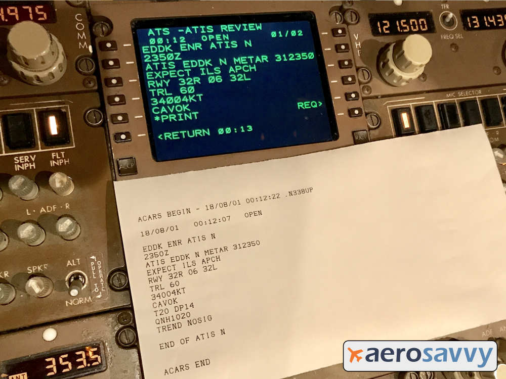
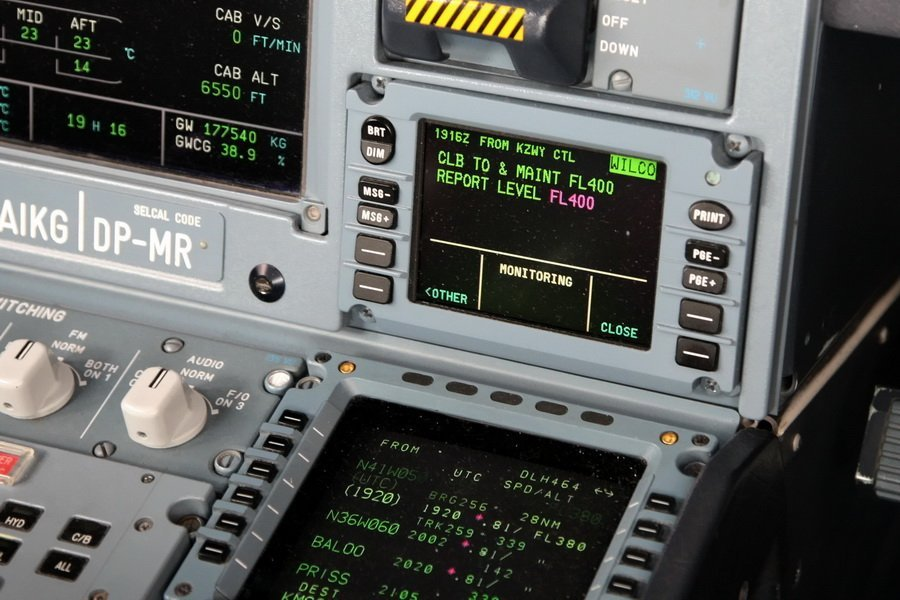
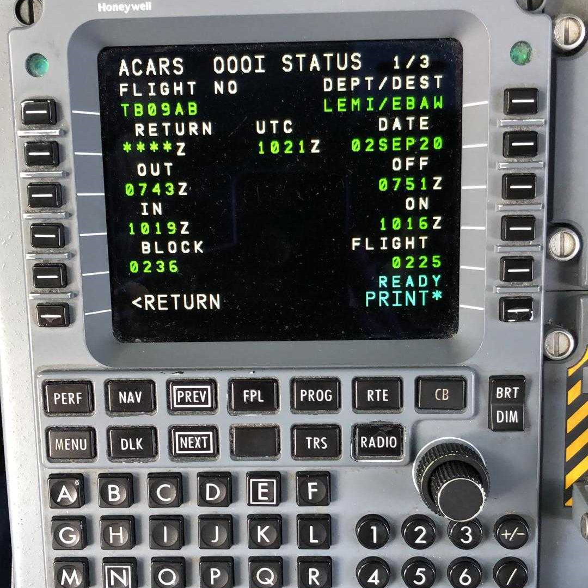

# ACARS UI visual references and design ideas

Created October 12, 2026. This document collects cockpit photographs and
design ideas for the ACARS receiver UI. The images are saved locally alongside
the documentation so the references remain available offline.

This is an exploration, not a final UI specification. The project presents
passively received ACARS messages. The proposed interactions below operate on
our local data: inspecting, filtering, reviewing, and exporting observations.
Responses visible in cockpit photographs are examples of the flight crew's
interface, not actions our receiver can send to an aircraft.

Read this together with the
[message interpretation and UI design reference](acars-message-interpretation-and-ui-design.md)
and the fixed [478-record reference log](acars_20261012.reference.jsonl).
The interpretation document analyzes the first 456 records of that snapshot.

## 1. Received airport information: readable text and print view

**Source and credit:** [AeroSavvy — ATIS: Automatic Terminal Information Service](https://aerosavvy.com/atis/).
The original photograph includes AeroSavvy's watermark, which is preserved.

### What the photograph shows

- A received D-ATIS message for Cologne (`EDDK`) with airport weather and
  runway information.
- A message title, UTC time, status, and page counter above the body.
- Green text on a dark background, preserving the compact operational format.
- Controls adjacent to the display for requesting information, printing,
  and returning to another page.
- A paper printout that retains more of the message than is visible on the
  current display page.

This illustrates the response a crew might receive after the ATIS requests
represented by `B9` and `5D` messages in our reference log. The cockpit photo
shows received airport information; those particular log records are requests.

### Ideas for our UI

- Give a selected message a readable title and a clear, spacious body.
- Preserve the actual line breaks, airport identifiers, abbreviations, and
  original text. Offer decoded explanations as additional information.
- Place reception time, embedded report time, aircraft, frequency, and
  message category in a consistent metadata area.
- Use monospaced text for the original payload and aligned operational values.
- Provide a print/export view that includes the full message and provenance.
- Allow a long report to scroll while keeping its identifying information
  visible. Physical cockpit page limits are not a requirement for our UI.

## 2. Airbus CPDLC: message identity, body, and state

**Source and credit:** [FLYHT — FANS 1/A](https://flyht.com/communications-solutions/fans-1-a/).

### What the photograph shows

- An Airbus DCDU: Datalink Control and Display Unit.
- A controller message identified by its UTC time and ground facility.
- An instruction to climb to and maintain FL400, and report reaching that level.
- The crew's `WILCO` response, meaning “will comply.”
- Separate areas for the instruction, response/status, and available controls.
- Controls for message navigation, paging, printing, and closing the view.

This is a crew-facing CPDLC example, related to the `.AT1` application traffic
identified in the log. The photograph is supplied by a provider of ACARS/FANS
services over satellite; the appearance of the crew interface does not tell us
which radio bearer carried a particular message we received locally.

### Ideas for our UI

- Keep the message body visually distinct from identifiers and status.
- Show application-level responses only when they have actually been decoded
  from received data.
- Keep three different concepts separate:
  - **Radio-link acknowledgment:** the ACARS `ack` field.
  - **Application response:** decoded content such as a crew response.
  - **Local review state:** whether the user has viewed or bookmarked a record.
- Make fragment state explicit: complete, incomplete, continuation, or unknown.
- Allow next/previous navigation within an aircraft's message history.
- Preserve undecoded CPDLC text until an application decoder provides a
  supported interpretation. A hexadecimal payload alone is not a readable
  ATC instruction.

The current native build omits `libacars`, so these application payloads are
stored in their encoded form. Additional application decoding remains a
possible future software change.

## 3. ACARS OOOI: structured flight summary

**Source and credit:** [CrewLounge — Capture Hours from ACARS Display](https://crewlounge.aero/news/pilot-logbook-acars-oooi/).

### What the photograph shows

- A flight identifier and departure/destination pair.
- The date and a UTC clock reference.
- The four OOOI events:
  - **OUT:** departure from the gate/parking position.
  - **OFF:** takeoff.
  - **ON:** landing.
  - **IN:** arrival at the gate/parking position.
- Separate block and flight durations.
- Page navigation and a print option.

This is an example of information ACARS can report automatically. It does not
establish that our reference snapshot contains a complete OOOI sequence for
any particular aircraft.

### Ideas for our UI

- Give each aircraft/flight a compact summary of known identifiers and routes.
- Present verified operational events as a timeline or labeled values.
- Show unknown event times as unknown instead of filling them from reception
  time or an assumed flight schedule.
- Calculate block time from OUT to IN and flight time from OFF to ON only
  when the event dates, times, and flight association are established.
- Preserve UTC while offering Eastern time for local viewing. Include dates
  when events span midnight.
- Link every derived event or duration to the original supporting record(s).

## Suggested information layout

The photographs suggest clear information hierarchy, consistent metadata,
and readable message bodies. We can use those ideas in a responsive receiver
application without making a literal reproduction of cockpit hardware.

| Area | Proposed information and behavior |
|---|---|
| Input context | Identify live reception or the fixed reference file. When available, show receiver state and time of the latest observation. |
| Message list | Reception time, aircraft registration, transmitted flight identifier, category, and a short readable preview. Filter by aircraft, label/category, frequency, text, and time. |
| Selected message | A title, decoded fields where supported, the complete text body, source identity, timestamps, and fragment/duplicate information. |
| Aircraft detail | Received identifiers, known routes, a message timeline, and verified position or operational events. |
| Raw details | The unchanged JSON, protocol fields, decoder provenance, and links to the contributing source lines. |

A first implementation could center on the message list and selected-message
view. Aircraft summaries, maps, OOOI timelines, and richer application decoding
can build on verified data rather than being assumed available for every flight.

## Visual direction to explore

- A dark reading view inspired by the photographs, with a light mode for
  long reading sessions and printing.
- Restrained green or cyan accents for selected information, with readable
  contrast and a clear text hierarchy.
- Monospaced payloads and numeric values; ordinary interface text for navigation
  and explanations.
- Status communicated through text and shape as well as color.
- Comfortable desktop and mobile layouts with readable type and large enough
  controls. Dense cockpit key arrangements are visual references rather than
  required controls for this application.

## How these ideas map to our recorded data

| Reference log example | Candidate presentation | Interpretation limit |
|---|---|---|
| Line 342, `G-VIIL` / `BA0181`, parking-stand request | Readable crew-message detail with the reported ETA and original text. | This is an outbound request; there is no stand assignment in that record. |
| Line 141, `N809NW` / `NW0047`, turbulence question | Company-message category and plain-language text view. | Preserve the transmitted flight identifier without assuming an operator. |
| Line 193, `OO-SFC`, route and explicit coordinates | Route/position summary linked to its source record. | Header and payload flight identifiers differ; other numeric units need a verified layout. |
| Line 65, `9V-SWH` / `SQ0026`, FMC position/waypoints | Navigation report detail and, later, verified waypoint information. | Compact coordinates require the correct format before map plotting. |
| `N481UA` messages in group `D32`, hydraulic report | Grouped report with a readable fragment sequence and original blocks. | Some blocks are missing; proprietary numeric values remain unresolved. |
| Line 389, `N516GJ`, APU history with printed units | Maintenance report with clearly labeled hours and cycles. | Do not invent fault severity or expand unlabeled neighboring values. |
| Line 68, `9V-SWH`, `SA` Media Advisory | Aircraft communications event with affected link and event time. | Aircraft link status and the local SDR's status are separate concepts. |
| `B6` / `BA` application payloads | ADS-C/CPDLC category, original encoded text, and future decoded fields. | The current build has not decoded the application payload. |

Line numbers refer to the fixed [reference log](acars_20261012.reference.jsonl),
not to a growing live file.

Many engine, hydraulic, and other condition reports are generated automatically
for ground monitoring. Their presence in our receiver log does not imply that
the flight crew reads each one as an inbox message. Honeywell describes both
automatic reporting and customizable crew pages in its
[ATSU AOC brochure](https://aerospace.honeywell.com/content/dam/aerobt/en/documents/landing-pages/brochures/N61-2460-000-001-HON-ATSU-bro.pdf).

## Local image assets and provenance

The following third-party reference images were retrieved on October 12, 2026
and saved without editing. Credits remain with their original publishers.
They are visual research references for this document.

| Local file | Dimensions | Original image |
|---|---|---|
| [acars-datis-display-and-printout.jpg](images/acars-ui/acars-datis-display-and-printout.jpg) | 1000 × 750 | [AeroSavvy image](https://i0.wp.com/aerosavvy.com/wp-content/uploads/2018/08/D-ATIS-Screen-EDDK-1000.jpg?ssl=1) |
| [airbus-cpdlc-display.jpg](images/acars-ui/airbus-cpdlc-display.jpg) | 900 × 600 | [FLYHT image](https://flyht.com/wp-content/uploads/2021/12/CPDLC-display-Airbus.jpg) |
| [acars-oooi-status.png](images/acars-ui/acars-oooi-status.png) | 1080 × 1080 | [CrewLounge image](https://crewlounge.aero/wp-content/uploads/2020/09/acars_2.png) |

## Decisions still to make

- Initial platform and primary screen size.
- Preferred visual style and the balance of compactness versus reading comfort.
- Whether to begin with live data, reference-file replay, or both.
- The first supported payload formats and application decoders.
- Rules for grouping aircraft/flight identities, fragments, and repeated observations.
- Which verified structured views to prioritize after the message reader.

No UI implementation, receiver changes, or new live reception were performed
as part of collecting these references.
